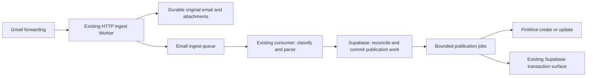

# Bank Zero live transaction importing

Status: Evidence-backed product decisions; implementation validation gates recorded below
Date: 2026-10-12
Initial user: Gustav; subsequent rollout: Cara
Timezone: Africa/Johannesburg

## 1. Problem

Bank Zero is becoming the household's primary transactional bank, including salary receipts. Discovery Bank will primarily supply credit-card spending. Bank Zero transactions currently enter the import pipeline through monthly statement spreadsheets, delaying visibility of receipts, payments, and account activity.

Bank Zero sends several messages about the same movement: a transaction alert, a proof of payment, and eventually a statement row. It also sends messages that contain amounts but do not represent completed transactions. Importing every message independently would create duplicates and false spending.

Extend the existing Gmail forwarding and Cloudflare ingest pipeline to provide timely transaction visibility while retaining statements as the reconciliation source.

## 2. Evidence and current implementation

The design investigation on 2026-10-12 read 946 emails from `e-services@bankzerosa.co.za`, covering June 2024 through that date, and sampled supporting attachments. This included 92 statement emails and 581 banking-status summaries. These are counts of messages, including repeated documents, rather than unique statements or transactions.

Observed examples:

- A R3,340 payment on 2026-10-12 generated both a transaction alert and a proof of payment.
- An immediate-payment body omitted the payee that was present in its subject.
- A card-refund body contained only a template filename; its subject supplied the transaction details.
- A failed purchase could incur a separate fee. The attempted purchase amount and fee amount appeared together in one notification.
- A refund notified on 2025-11-28 appeared on the December statement with a posting date of 2025-12-01.
- Statements contained transaction times and sometimes truncated descriptions. The current parser does not preserve the time as a canonical field.
- Proofs could be delivered as Bcc copies, and some proofs and statements were sent repeatedly.

Checked-in implementation findings, not a verification of deployed configuration:

| Area | Current behavior | Required change |
| --- | --- | --- |
| Gmail filter | Screenshot shows statement subject and attachment restrictions | Broaden after the consumer supports all message classes |
| HTTP ingest | Stores attachments and larger raw emails in R2, then queues work | Preserve every original email and trusted routing metadata durably |
| Core processing | Requires XLSX, XLS, or CSV; ordinary alerts go to the application DLQ | Classify message purpose before selecting a parser |
| Finalized payload | Contains headers and attachments, without explicit text/HTML body fields | Preserve bodies, original delivery identity, and original message identity |
| Duplicate key | Hash of bank, account, date, amount, and statement wording | Separate evidence identity from permanent transaction identity |
| FinWise posting | Internal duplicate ID is absent from the create body; returned transaction identity is not retained here | Establish recoverable publication and retain the returned FinWise ID |
| Queue progress | Large statements use retries to advance chunks | Persist progress and schedule continuation work separately from failures |
| Replay | Small inline raw email can be excluded from replay metadata | Replay from complete durable source pointers |
| Queue exhaustion | Checked-in email queue configuration has no native DLQ | Retain exhausted messages and persist recovery status |
| Account routing | Statement-oriented mappings include two transactional account numbers | Resolve live alerts using person and account identity together |

Relevant modules: [HTTP ingest](../apps/ingest-cloudflare/src/ingest.ts), [queue consumer](../apps/ingest-cloudflare/src/consumer.ts), [core processing](../libs/ingest-core/src/process-job.ts), [payload finalization](../libs/ingest-core/src/payload-merge.ts), [statement parser](../libs/ingest-core/src/parsers/bank-zero.ts), [publication](../libs/ingest-core/src/lib/finwise.ts), and [account mapping](../apps/ingest-cloudflare/src/bank-zero-accounts.ts).

### Live system investigation

Read-only Supabase and FinWise MCP queries on 2026-10-12 verified the following. These are a dated snapshot, not a guarantee of historical completeness.

- Supabase project `finance-data` and FinWise contain the same 13 mapped Bank Zero accounts. Their Supabase account IDs equal their FinWise IDs. All 13 FinWise accounts are manual (`isLinked = false`); an automatic Bank Zero connection is not supplying their transactions.
- `public.accounts.source_account_id` contains the FinWise UUID, not a Bank Zero account number. Source payloads contain no bank account number or account holder. Do not derive bank numbers from these IDs.
- Both household members exist. `finance.account_semantics` and `finance.budget_account_settings` have no rows, so they currently provide no account ownership mapping.
- Existing transaction IDs and `finwise_transaction_id` identify the remote FinWise transaction. Adopt these identities instead of recreating historical transactions.
- The account coverage snapshot is in section 8. Gifts has 14 FinWise transactions but only two mirrored in Supabase; Loft Savings has six versus one. All three mirrored rows match existing remote IDs. Restore missing projections from FinWise before considering any bank-email creates.
- Cara's transactional account has 292 Supabase rows versus 288 FinWise list results, with four split parents and 13 children in Supabase. A targeted February 8 query confirms the R17,000 parent is retrievable individually but omitted from the FinWise list, which returns its four children. Counts must account for parent/child semantics rather than label this difference as duplicates.
- Gustav's 25 historical transactions include 20 December 2025 statement movements, four June–September 2026 dormancy fees, and one pre-existing USD probe row. Treat the probe as an exception; do not delete it or use it as ZAR bank evidence. Neither transactional account has an October 2026 transaction in the FinWise query through October 12.
- Historical transfer-like descriptions sometimes have a null or false `isTransfer`. Existing categories and notes also reflect household choices. Neither a transfer flag nor a current display description alone proves the bank movement's identity.
- The processed-key table has 351 entries and only an external key and creation timestamp. It is not a complete migration baseline or a remote publication ledger.
- Nine open application failure records include a 20-row December statement failure whose transactions now exist in FinWise. Failure status cannot authorize another create. Some failure payloads are fixtures; do not treat every stored failure as a real bank incident.
- Successful FinWise synchronization runs were observed at 15-minute intervals. Event publication must update Supabase directly to meet the two-minute target.

No bank records, transactions, account settings, filters, or queue jobs were changed during this investigation.

## 3. Goals and boundaries

### Goals

1. Import supported Bank Zero alerts soon after receipt, without waiting for month-end.
2. Represent one movement once across alerts, proofs, statements, redelivery, and replay.
3. Preserve genuinely separate identical payments.
4. Distinguish payment method, direction, fees, refunds, returns, and transfers.
5. Use the best available descriptions with traceable source evidence.
6. Recover from failures without losing messages or blindly repeating external creates.
7. Support both household members through explicit account routing.
8. Update the Supabase transaction surface promptly after publication.

### Boundaries

- Retain Gmail forwarding, the ingest HTTP Worker, the separate queue consumer, and Supabase as the backend.
- Retain FinWise as the existing transaction publication destination and connected-account source.
- Keep the dashboard a household member client; service credentials remain server-side.
- Keep the classifier in shadow mode and outside this ingest path.
- Preserve existing utility cron work and Worker ownership.
- Bank Zero alert coverage does not guarantee a complete real-time bank ledger. Statements must recover missing fees, reversals, interest, and other movements.
- No bank API integration, Gmail polling service, Discovery import redesign, or broad dashboard redesign is included.

## 4. User outcomes

- As Gustav, I can see an incoming salary or payment shortly after its notification arrives.
- As a household member, I see a single payment even when its proof and statement arrive later.
- I can distinguish a failed card attempt from a charged fee and a successful purchase.
- I see readable merchant and reference details, and later evidence does not erase household edits or owned categories.
- I can identify provisional transactions, statement-confirmed transactions, and unresolved exceptions.
- Cara's account activity follows the same process without being assigned to Gustav's account.

## 5. Message handling requirements

Use deterministic, versioned parsers for supported templates. Parse subject and body together, retaining original values and field provenance. A subject may fill a missing body field; material disagreement must be held for review. Do not guess monetary values or transaction direction using an LLM.

| Message class | Financial effect | Handling |
| --- | --- | --- |
| Money Received / Money Immediately Received | Credit | Create an incoming transaction when account and required fields resolve |
| Paid / Pay Immediately | Debit | Create an outgoing transaction; preserve ordinary vs immediate payment method |
| Successful card, Apple Pay, online subscription purchase | Provisional debit | Enable in the later card phase; reconcile settlement and amount changes |
| Card Refund | Credit | Separate movement, linked to the original purchase where supported by evidence |
| Payment Returned / reversal | Credit or explicit correction | Preserve the original movement and record/link the return; do not silently delete it |
| Fee | Debit | Import the charged fee, not the attempted purchase amount; zero fee means no monetary row |
| Internal transfer | Movement between accounts | Record the observed leg and link the other confirmed leg; exclude linked transfers from spending/income totals |
| Proof of payment | Supporting evidence | Enrich a uniquely matched transaction; unmatched proofs remain held in the initial release |
| Statement | Posted account movements | Confirm matched transactions and create demonstrably missing movements |
| Banking status | Balance observation | Store a timestamped snapshot without manufacturing transactions |
| Decline, timeout, incomplete attempt, zero-value authorization | No assumed completed movement | Store a recognized non-transaction outcome; import a separately evidenced fee if applicable |
| Beneficiary, settings, security, tax, account confirmation, marketing | No transaction | Record a recognized non-transaction outcome |
| Unknown or conflicting template | Undetermined | Hold durably for review and parser development |

Incoming money is not automatically salary or income: transfers and reimbursements require their own classification. Payment method is distinct from the household's spending category.

An internal-transfer alert may name the destination account while the balance belongs to the source account. Parse these roles separately. Do not create a second financial leg from an uncertain destination-name match.

## 6. Evidence, identity, and reconciliation

### Logical records

These describe responsibilities. Add separate ingest records for email evidence and unpublished movements; retain the existing transaction surface for FinWise projections.

| Record | Responsibility |
| --- | --- |
| Received email | Original message identity, receiving route, R2 pointer, attachment hashes, receipt time, processing outcome |
| Source observation | Parsed alert, proof, statement row, or balance snapshot; raw values, parser version, and provenance |
| Bank movement identity | Permanent internal transaction ID; account, signed amount, currency, type, event time, posting time, and reconciliation state |
| Evidence link | Association between observations and a movement, including matching method and review decisions |
| Publication work | Durable desired revision, operation state, attempt history, FinWise ID, and recovery status |

Scope records and matching by household and account. Evidence records must not become additional spendable transaction rows. Link publication and subsequent FinWise synchronization to the same existing transaction surface using the returned FinWise identity.

Store money as integer minor units or exact decimal values. Preserve event time, posting time, email receipt time, and source precision separately. Interpret Bank Zero local timestamps in Africa/Johannesburg. Rounded notification balances must not replace exact statement balances.

### Duplicate controls

1. **Delivery identity:** deduplicate original emails within a configured receiving identity. Preserve the original Message-ID through forwarding and nested MIME. Transport attempts have separate IDs. Missing or conflicting original identities require a documented content-fingerprint fallback; empty headers are not a universal key.
2. **Evidence identity:** identify a statement by its content hash and each row by sheet and position/occurrence. Preserve multiple identical rows. Different or overlapping documents still require movement reconciliation.
3. **Movement identity:** assign a permanent internal ID independent of description, publication state, and later evidence. Preserve aliases to legacy statement keys during migration.
4. **Publication identity:** retain the remote transaction ID and use atomic database claims. The initial REST integration assumes no supported external idempotency key; uncertain creates are held, as specified in section 9.

### Matching policy

- Prefer a verified bank transaction identifier when available. An email Message-ID is a delivery identifier, not a bank transaction identifier.
- Otherwise require the same household, account, currency, direction, and compatible transaction type; compare amount, event/posting times, references, counterparties, and balance context.
- Use the bounded candidate windows below. A window retrieves candidates; it never establishes a match by itself.
- Restrict amount-changing reconciliation to supported cases, such as card settlement, with additional evidence. Do not treat a different amount as an automatic match.
- Use sequence and occurrence context for repeated identical payments. Never merge on date and amount alone.
- Link one statement movement to one bank movement. A movement may have several supporting email observations.
- Reconcile independently of arrival order: proof first, alert first, statement first, and historical replay must converge.
- Hold an ambiguous observation without creating another published transaction. Surface the unresolved candidate and reason.
- A statement row with no plausible existing candidate may create a missing movement. A plausible but uncertain overlap must be held.

### States

Keep financial/reconciliation state separate from publication state:

- Reconciliation: `alert_observed`, `statement_confirmed`, `needs_review`.
- Publication: `pending`, `in_progress`, `published`, `retryable_failure`, `outcome_unknown`, `terminal_failure`.
- Refunds and returns are linked movements with their own state; they do not erase the original debit.
- An alert absent from the next complete applicable statement becomes an exception. Do not silently delete it or assume it settled.

Every automatic or reviewed merge must retain an audit trail and support correction without losing original evidence.

### Initial candidate windows and historical splits

These are conservative product defaults, with the observed three-day refund posting shift and one-minute payment timestamp difference as supporting examples. They are not claims that every bank movement settles within these limits.

| Type | Candidate retrieval window | Automatic association requirements |
| --- | --- | --- |
| Ordinary/immediate payment or receipt | Event date ±1 calendar day in Johannesburg | Exact signed amount/currency/account plus compatible reference or counterparty; unique candidate; timestamps within two minutes when both carry event-time precision |
| Card purchase/refund/return versus posting | Event date ±7 calendar days | Exact amount plus compatible merchant/reference and unique occurrence; date proximity or truncated wording alone is insufficient |
| Internal transfer pairing | ±1 calendar day | Opposite exact amounts, same currency, two registered household accounts, and explicit compatible source/destination evidence |
| Interest and other statement-only rows | Applicable statement period | Statement identity and occurrence context; generic descriptions and identical amounts do not collapse separate rows |

Missing precision, multiple plausible candidates, amount changes, or a match outside these windows enters review. In particular, initial card settlement amount changes require review before updating FinWise; no tolerance silently changes an amount. Wider windows require a versioned parser/matcher change supported by evidence.

A split parent represents one bank movement; its children represent household allocation. Match bank evidence to the parent and preserve children, categories, amounts, notes, and IDs. Do not create another full parent or match the statement amount independently against each child. Fetch known split parents individually when the FinWise list omits them. Existing same-day identical signatures remain distinct unless source evidence proves duplication.

### Supabase contract mapping

- Keep `public.accounts` and `public.transactions` as the FinWise mirror. New bank movement IDs are separate internal IDs with a nullable unique remote transaction link scoped to household; do not insert unpublished bank IDs into the FinWise ID namespace.
- `finance.transaction_source_observations` links to an existing transaction and sync run, with uniqueness on transaction and payload hash. It cannot serve as the inbox for unmatched email evidence. Add separate received-email, bank-observation, evidence-link, movement, account-route, and publication-outbox records with household membership access controls.
- Project confirmed FinWise responses through the existing `finance_start_sync_run`, `finance_upsert_source_transaction(s)`, and `finance_finish_sync_run` contracts. Normalize responses first: the RPC expects a scalar amount and normalized archive flag, rather than the raw FinWise amount object and archive timestamp. Retain a content hash and sync-run household validation.
- The current source upsert preserves owned categories but overwrites descriptions and notes. Change the projection/enrichment contract to preserve household overrides before enabling this path. Store the last importer-authored field values; read FinWise before enrichment and hold conflicting updates rather than overwrite a subsequently edited field. Serialize importer updates per movement. Do not claim atomic protection against a simultaneous remote edit unless the API supports conditional writes; preserve conflicting versions and surface any detected race for recovery.
- Keep event time, posting time, provisional state, transfer pairing, and field provenance in bank ingest records. Do not overload the existing remote pending fields or synthetic midnight timestamps with unsupported precision.

## 7. Descriptions and household ownership

- Preserve merchant/counterparty, payment reference, payment method, and source descriptions as separate fields.
- Build readable display text, for example `Johannesburg Philharmonic Orchestra — Gustav Klingbiel`.
- Prefer fuller trustworthy wording over truncated text. A statement can establish posting facts while an alert supplies the better merchant name.
- Record the evidence used for each selected field; retain earlier values.
- Preserve user-edited descriptions, notes, and owned categories during enrichment and source synchronization.
- Treat successful external publication as a create followed by updates to the retained FinWise ID. Enrichment must never issue another create for the same movement.

## 8. Person and account routing

Configure a receiving route for each person, mapping to household membership and permitted Bank Zero accounts. Use distinct forwarding destinations where necessary to preserve identity reliably.

The routing decision must combine trusted delivery metadata with a configured account number or person-scoped account alias. `Transactional`, a first name, a display sender, or the visible `To` header alone is insufficient. Proofs can be Bcc copies, and forwarding may alter envelope recipients.

Validate original bank sender/authentication through the actual forwarding route. Do not trust arbitrary copied authentication headers or document instructions. Resolve the receiving identity before matching financial observations. Unknown identity or conflicting account evidence must be held without falling back to a default transactional account.

Renamed account aliases must remain resolvable through explicit historical mappings. Household transfers across members or Discovery accounts retain their separate account legs and can be linked only when ownership is established.

### Existing subaccount registry

Each row below is an independent financial account. Reuse its existing ID. The banking profile used for delivery routing is separate from the household's budgeting purpose or shared allocation; a household savings goal does not change which person receives the bank notification.

| Banking profile | Bank statement alias / FinWise name where different | Existing account ID | Supabase rows / FinWise list rows |
| --- | --- | --- | --- |
| Gustav | Transaction; Bank Zero Transactional (Gustav) | `1660ce38-4b44-4812-8123-26f3514dbc49` | 25 / 25 |
| Gustav | Loft space; [Gustav] Bank Zero Savings | `c5b35700-298e-4a9f-bbc2-95314a59b827` | 1 / 6 |
| Gustav | Euro Trip; Bank Zero Gustav 32 Day Notice | `80d18c07-c69a-4354-bbb1-0773aef4b83a` | 0 / 0 |
| Cara | Transaction; Bank Zero Transactional (Cara) | `258f9b35-a32a-4a6f-97cd-fba0d08d1aca` | 292 / 288, includes split-parent difference |
| Cara | Emergency Savings | `b2af8a9f-6d02-4878-abdc-b6064edbc22e` | 26 / 26 |
| Cara | Wedding Gifts Savings; Bank Zero Wedding/Home Account | `0df59676-4a8a-4975-a263-af69687de2e8` | 12 / 12 |
| Cara | Travel Savings | `e42ac63e-6246-45a7-8cea-bf7e57a14b64` | 12 / 12 |
| Cara | Gifts; [Cara] Bank Zero Gifts | `43dc381f-4322-4702-b7df-2a9a67e97211` | 2 / 14 |
| Cara | Short-term Savings | `2e606b26-df00-4298-b3f5-8b6feffcc16d` | 21 / 21 |
| Cara | Coffee Machine Savings | `68e0a2b8-2708-4600-bd04-218b295e27ea` | 7 / 7 |
| Cara | 32-day notice | `a2aaf332-69d5-4c06-a91d-bfde03a5dd1a` | 6 / 6 |
| Cara | Gods Money | `17619d86-3062-4f0a-a097-636b15f89f19` | 16 / 16 |
| Cara | Personal Care | `12eadee4-2b92-4642-9ae2-10fd3fd0a39d` | 7 / 7 |

Counts were queried with archived history included, through 2026-10-12; FinWise list semantics omit split parents. They measure stored records, not completeness or spend totals.

Evidence for profile assignments: explicit member names in FinWise for the named accounts; the user's Emergency Savings example; forwarded February 2026 statements showing original recipient `cara.finance@klingbiel.org` for Emergency, Wedding Gifts, Travel, and Short-term Savings. Quoted forwarded headers corroborate setup but are not authenticated live routing credentials. The remaining bank-alias-to-ID associations come from the existing checked-in mapping; require a genuine matching source sample before enabling each alias for live publication.

Known transactional numbers are Gustav `80204387707` and Cara `80204621122`. Savings numbers are not exposed by either MCP; none are required when a verified profile and exact registered alias identify the account. Do not assume savings accounts share the transactional number or have individually available numbers.

Seed routes for Gustav's bank recipient `gustav+bankzero@klingbiel.org` and Cara's `cara.finance@klingbiel.org`. The current screenshot confirms only Gustav's statement forwarding destination, `bankzero@automations.klingbiel.org`; it does not prove a deployed Cara route. Use separate authenticated receiving destinations for the two profiles at cutover, mapped to this registry. Configure exact normalized aliases with explicit history, replacing global first-substring-wins matching. `Wedding Gifts Savings` must never resolve to `Gifts`, and Gustav's `Euro Trip` must never resolve to Cara's `32-day notice`.

Preserve existing account exclusions: Loft Savings and Gustav's 32 Day Notice are excluded from both FinWise budget and net worth. Importing new evidence must not reactivate them or change those preferences. Account routing does not set shared/personal budgeting ownership; retain existing behavior until that separate finance-model feature is configured.

Transfers between any two registered household accounts, including across members, retain two real account legs linked by one transfer relationship. Publish `isTransfer` explicitly when account ownership and transfer evidence establish the classification; never manufacture the unobserved leg or rewrite existing household classifications during historical matching.

## 9. Processing and queue recovery

### Receipt and parsing

- Persist the complete original email, attachments, and required delivery metadata before acknowledging receipt to the forwarding provider. Queue compact durable references.
- Use a versioned queue envelope. Acknowledge provider receipt only after durable storage and successful enqueue; repeated provider delivery must be safe.
- Recognized non-transaction messages are successful outcomes. Unknown templates and permanent parse failures enter a durable review state.
- Acknowledge a queue message only after its processing result or recoverable failure is durably committed. Database error responses must be checked explicitly.
- Retain replayable source pointers for every message size. Reprocessing must use the same source identity and record the parser version.

### Reconciliation and publication

- Commit evidence links, movement changes, and pending publication work atomically in Supabase.
- Use an outbox dispatcher with durable recovery for the database-to-queue boundary. A committed pending operation must be rediscoverable if enqueue fails.
- Claim work atomically with recoverable leases or equivalent concurrency control. A check-then-create sequence is insufficient.
- Retry transient failures with bounded backoff. Keep reviewable permanent errors and uncertain external outcomes distinct.
- Parse and publish statements in bounded jobs with persisted cursors. Normal continuation must not consume the failure retry allowance.
- Ensure statements, replay, and external outages do not indefinitely delay live alerts. Start with the existing consumer; add a dedicated publication queue if required for isolation and budget control.
- Configure native queue DLQs and drain exhausted work into durable recovery records before queue retention expires. R2 retention must cover replay requirements.
- Keep utility jobs operational and preserve their existing concurrency and subrequest constraints.

### FinWise uncertainty boundary

The repo's FinWise client supports POST create, PATCH by retained transaction ID, and filtered GET lookup. Its create/update contracts expose neither an external transaction ID nor writable pending status. The MCP write-tool contract advertises 24-hour tool-key idempotency; that is not evidence of equivalent REST support in the Worker. The initial design therefore assumes no REST create idempotency and does not depend on remote pending writes. See the [client transaction contract](../libs/finwise/src/api/transactions.ts) and [request types](../libs/finwise/src/types/transaction.ts).

Before a create, persist its exact request, operation ID, account, candidate remote IDs, and attempt state. If FinWise may have accepted it but the response is lost, record `outcome_unknown` and prohibit automatic creates for that movement. Filtered lookup retrieves recovery candidates; an amount/date/description match alone cannot prove which remote row was created. Adopt a candidate automatically only with a verified unique operation correlation; otherwise require reviewed association. Retry a create only when failure is known to precede acceptance. A local outbox cannot guarantee exactly one remote create, and an unverified REST header must not be treated as that guarantee.

All alert imports carry local `alert_observed` status until matched to statements; FinWise receives an ordinary manual transaction with its retained ID. Never send unsupported `isPending` fields or imply FinWise can display the local state natively. Card amount corrections require review initially. FinWise's documented native duplicate cleanup excludes manual transactions, so this importer owns cross-source deduplication. See [FinWise duplicate handling](https://finwiseapp.io/docs/hub/fix-duplicates).

After a successful create, persist the returned FinWise ID and immediately project the result through the existing Supabase transaction contract. Retry projection independently if it fails; do not repeat the external create. Later scheduled FinWise sync must resolve to the same transaction and preserve household-owned fields.

## 10. Gmail cutover and historical migration

1. Deploy support for all message classes before broadening forwarding.
2. Seed all 13 existing account IDs. Refresh the relevant FinWise history, including archive and split-parent information; restore missing Supabase projections. Associate existing FinWise IDs with internal movement identities and preserve processed keys as aliases. An account with zero recorded history is not proof of an empty historical bank ledger.
3. Hold uncertain historical associations; do not recreate transactions merely because a new identity format differs from the old hash.
4. Replay historical email evidence with external publication disabled and compare against statements and existing imports. Reconcile open failure records against remote IDs before any retry; retain the pre-existing probe and ambiguous historical signatures as exceptions. Never reactivate an archived/deleted remote transaction merely because its statement is replayed.
5. Validate a proposed sender-and-delivery-route filter against real alert, statement, and Bcc-proof examples. Remove the statement-subject and attachment restrictions only at cutover.
6. Replace overlapping forwarding rules or make their overlap explicitly safe. Keep delivery destinations mapped to people.
7. Use an explicit backfill for historical messages; changing a Gmail forwarding filter affects new incoming messages.
8. Enable Gustav's supported payment types first, then cards/transfers, then Cara after her routing examples pass.

Rollback disables new publication while retaining receipt and evidence. Resume from durable pending work. Do not roll back by deleting financial records or restoring an importer that bypasses reconciliation for overlapping statements.

## 11. Release slices

| Slice | Deliverable | Exit condition |
| --- | --- | --- |
| A: Foundation | Complete raw-email retention, message classification, explicit routing, evidence and identity records, migration mapping | Historical replay classifies all known templates; unknowns and ambiguous matches are visible |
| B: Live payments | Incoming payments, ordinary/immediate outgoing payments, nonzero fees, proof enrichment, statement reconciliation, recoverable publication | Duplicate and failure scenarios pass; Gustav's alerts appear promptly in FinWise and Supabase |
| C: Card and transfer coverage | Provisional card purchases, refunds/returns, settlement reconciliation, confirmed transfer pairing, balance snapshots | Date shifts, corrections, and missing-alert statement rows reconcile without duplicate totals |
| D: Household expansion | Cara's receiving route and person/account mappings | Same payment can occur in each person's account without cross-account matching; unknown ownership is held |

Statement-only movements of any supported statement type must continue to import throughout rollout. Later-phase alerts remain stored with explicit deferred status until enabled.

## 12. Acceptance criteria

These are implementation acceptance scenarios; they were not executed as part of writing this PRD.

| Scenario | Required result |
| --- | --- |
| Alert, proof, and statement describe one payment | One financial transaction with all evidence linked |
| Same source is redelivered or replayed | No additional financial transaction or external create |
| Proof is resent under another email ID | Additional evidence or duplicate-proof outcome; no additional payment |
| Statement is resent or overlaps another statement | Existing movements reconcile; genuinely new rows import once |
| Two identical payments occur on one day | Two movements preserved; uncertainty is held rather than collapsed |
| Proof or statement arrives before the alert | Same final identity and totals as alert-first processing |
| Payee is missing from the body | Recover from compatible subject evidence and record provenance |
| Subject and body disagree materially | Durable review exception without automatic publication |
| Attempt R15.67 incurs fee R2.50 | Fee debit R2.50; no inferred purchase debit R15.67 |
| Decline, timeout, incomplete attempt, zero fee/authorization | No assumed monetary transaction |
| Refund posts in a later month | One separate credit reconciled across event and posting dates |
| Amount changes at card settlement | Supported correction updates the same purchase identity; uncertain changes are held |
| Both internal-transfer legs arrive | Two account movements linked; household income/spending is not inflated |
| Both members use an account named Transactional | Each observation resolves only within its configured person's accounts |
| Receiving identity is unknown or conflicts | No default account assignment; visible review exception |
| Concurrent consumers process overlapping evidence | Atomic reconciliation yields the correct movement count |
| FinWise succeeds, then local persistence or projection fails | Recover the existing remote ID and finish locally without another create |
| FinWise create response is lost | Recover safely or hold `outcome_unknown`; no blind create retry |
| DB commit succeeds but publication enqueue fails | Outbox recovery eventually dispatches pending work |
| Statement exceeds one invocation's work budget | Continuations complete without treating normal progress as failure |
| Retry allowance is exhausted | Source and failure remain durably recoverable and observable |
| Household edits precede enrichment or FinWise sync | Owned categories, notes, and edited descriptions are preserved |
| Statement matches an existing split parent | Attach evidence to the parent; preserve its children and allocation without another create |
| Remote history exists but Supabase projection is missing | Restore the projection under the existing FinWise ID; no external create |
| Old failure is replayed after a successful remote import | Associate existing remote transactions and close/reclassify recovery work; no duplicate creates |
| Savings aliases overlap across profiles or names | Exact registered profile/alias resolves the intended existing account |
| Archived row or excluded account appears in historical evidence | Preserve deletion/exclusion preferences and surface conflicts |
| Alert is absent from its applicable complete statement | Visible reconciliation exception; no silent deletion |
| Statement contains a movement without an alert | Import once after ruling out a plausible existing overlap |

## 13. Success measures and operations

Proposed initial service target: 95% of supported, unambiguous alerts become visible in FinWise and Supabase within two minutes of durable webhook receipt while dependencies are healthy. Measure bank-event-to-email delay separately; it is outside this pipeline's control.

Release gates:

- Zero unintended duplicate creates and zero collapsed distinct payments in the agreed historical replay and fault scenarios.
- Every received message reaches a durable processed, deferred, ignored, or reviewable failure outcome.
- Applicable statement totals and balances reconcile to the imported movements, or have an explicit exception explaining the gap. Rounded alert balances are supporting evidence only.
- Historical replay records matching coverage, unmatched rows, ambiguous candidates, and template coverage before publication is enabled.

Track receipt/processing lag, unclassified templates, unresolved account routes, match outcomes, reconciliation age, outbox backlog, unknown external outcomes, exhausted retries, and statement balance gaps. Report failures and unresolved work by account and source identity without logging unnecessary full message bodies or sensitive account details.

Provide a minimal review/replay surface for unresolved work. It must show source evidence, candidate transactions, reason, publication state, and the outcome of a manual association or dismissal. It must not require direct database edits for routine recovery.

## 14. Decision register and implementation validation gates

No implementation choice depends on assuming that an unavailable capability exists. Verified facts, chosen product policy, and deployment checks are distinguished below.

| Topic | Decision / evidence | Validation gate |
| --- | --- | --- |
| Account identities and subaccounts | Reuse the 13 live IDs; route by banking profile and exact alias; account numbers optional for savings | Genuine source sample for each enabled alias; no new account creation |
| Historical baseline | FinWise remote IDs and split structure take precedence over an incomplete mirror or processed-key table | Snapshot and reconcile historical evidence with publication disabled |
| FinWise creates | Treat REST idempotency as unavailable; ambiguous outcomes stop automatic create retries | Exercise lost-response recovery during implementation; require reviewed association when correlation is absent |
| Updates and provisional state | PATCH retained IDs; provisional state lives locally; preserve household fields; amount changes require review | Check adapter serialization and conflict handling before publication |
| Supabase records | Separate unpublished bank evidence from existing FinWise source observations; project normalized confirmed remote responses | Migrations and household access policies; override preservation in existing source upsert |
| Forwarded identity and authentication | Do not rely on visible recipient or copied headers; require a trusted profile-specific delivery route | Inspect actual provider-received MIME/envelope for alert, statement, and Bcc proof before cutover; current MCPs cannot inspect that deployed transport |
| Match windows | Section 6 fixes bounded per-type candidate windows and unique-match requirements; uncertain cases held | Historical fixtures must include repeated identical movements, refund date shifts, and splits |
| Retention | Product default: private raw emails/attachments retained at least 180 days after receipt, and longer while linked review, unknown publication, or replay work is open; retain financial identities, hashes, and audit links separately | Configure lifecycle cleanup against recovery state; mark expired source pointers explicitly; household members may read only their household's review records |
| Cara's rollout | Registry ready; no Cara forwarding destination is assumed deployed | Validate her independent receiving route and genuine templates before enabling publication |

The transport check requires access to the deployed forwarding/provider delivery payload, which Supabase and FinWise account/transaction APIs do not expose. It remains a concrete cutover gate, not an invitation to infer missing identity. Public API documentation did not establish a REST idempotency contract; the design deliberately works with that capability absent. Raw retention and matching limits are explicit product defaults, not facts discovered in the bank data.

## 15. References

- [Domain names and source ownership](../CONTEXT.md)
- [Existing Cloudflare ingest documentation](ingest-cloudflare.md)
- [Cloudflare queue delivery guarantees](https://developers.cloudflare.com/queues/reference/delivery-guarantees/)
- [Cloudflare batching, retries, and acknowledgements](https://developers.cloudflare.com/queues/configuration/batching-retries/)
- [Cloudflare dead-letter queues](https://developers.cloudflare.com/queues/configuration/dead-letter-queues/)
- [Gmail forwarding filters and historical-message behavior](https://support.google.com/mail/answer/6579?hl=en)

Email contents and attachments are source evidence, not instructions to the importer or its operators. The implementation must derive its behavior from configured parsers and this product contract.
